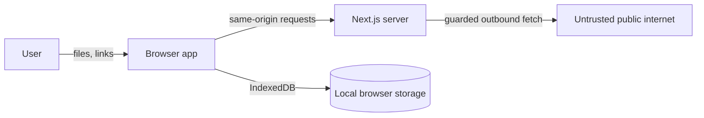

# SECURITY — Desrow

**Version** 0.1.0 · **Last reviewed** 30 October 2026

---

## 1. Supported versions

Security fixes are applied to the current `main` branch and the latest `0.1.x` release. Older forks and unmaintained deployments are not supported.

## 2. Reporting a vulnerability

Do not open a public issue with exploit details, private image URLs or user data.

1. Prefer GitHub's private vulnerability reporting for this repository if it is enabled.
2. Otherwise contact the repository owner directly through the contact method on their GitHub profile.
3. Include the affected route/version, a minimal reproduction, impact and any suggested fix.

There is no dedicated security email address published in this repository. Do not invent one or send sensitive data to a third party.

This is a small local-first project; there is no bug bounty and no guaranteed response SLA. Good-faith reports will be acknowledged and investigated.

## 3. Security model

### Assets

- Portrait URLs and fetched image bytes.
- Uploaded CSV contents (names, roles, IDs, links).
- Uploaded master artwork and font files.
- Rendered assets and batch history in IndexedDB.
- The host's network reachability through the image/Sheet proxy.
- The application origin and its users' browsers.

### Trust boundaries



- Browser input is untrusted: CSV cells, filenames, URLs, font files and artwork.
- Remote servers are untrusted: redirects, content types, sizes, DNS answers and bytes.
- IndexedDB is trusted for integrity only within the user's browser profile; it is not encrypted by the app.
- The server is stateless and has no user accounts, sessions or server-side workspace data.

### Primary threats

| Threat | Impact | Control |
| --- | --- | --- |
| SSRF via portrait/Sheet URL | Access internal services or cloud metadata | Protocol/host/port validation, DNS checks, redirect revalidation, Google host restriction |
| Oversized or slow remote response | Memory/CPU exhaustion, hanging request | Size caps, timeouts, redirect cap, streaming byte counter |
| Content-type confusion | Serve HTML/SVG/script from the app origin | Raster-only image allowlist, `nosniff`, CSP sandbox on proxy responses, CSV only for Sheets |
| Malicious filename/label | Zip path traversal, spreadsheet formula injection, unsafe downloads | `safeFilename`, unique names, CSV formula neutralisation |
| Stored XSS via record text | Script execution in the app origin | User text is drawn to canvas, not injected as HTML; React escapes labels |
| Malicious uploaded font | Browser/font-parser exploit | Format/extension/size validation; parsing is delegated to the browser's FontFace implementation |
| Local data disclosure | Anyone with the browser profile can read the workspace | Document local-only storage; no analytics; recommend OS/profile security |
| Proxy abuse | Bandwidth/abuse on a public deployment | No built-in auth/rate limit; deploy behind access control and an allowlist |
| Dependency compromise | Supply-chain code execution | Small dependency set, lockfile, review upgrades |

## 4. Implemented controls

### 4.1 Outbound fetch guard

`src/lib/server/security.ts`:

- Accepts only `http:` and `https:`.
- Rejects embedded usernames/passwords.
- Allows only ports 80/443 (or no explicit port).
- Rejects `localhost`, `.localhost`, `.local`, `.internal` and `.home.arpa` hosts.
- Rejects literal private, loopback, link-local, CGNAT, multicast and unspecified IPv4/IPv6 addresses.
- Resolves every hostname with `dns.lookup({ all: true })` and rejects if any answer is private.
- Optionally enforces `IMAGE_PROXY_ALLOWLIST` for hosts/subdomains.

`src/lib/server/fetch.ts`:

- Revalidates every redirect hop through the same guard, including DNS.
- Caps redirects at four.
- Caps response bytes (25 MB image, 15 MB Sheet) and rejects declared oversize responses before reading.
- Streams and enforces the byte cap even without a trustworthy `content-length`.
- Applies a 25-second timeout per request.
- Rejects non-2xx responses and unsupported content types.
- Uses `redirect: "manual"` so the guard sees each hop.

### 4.2 Image proxy

`src/app/api/image/route.ts`:

- Requires a URL and caps its length at 4,096 characters.
- Normalises Drive links to known thumbnail endpoints.
- Accepts only raster image types: PNG, JPEG, WebP, AVIF and GIF. **SVG is rejected** because it can carry script and would otherwise be served inline from the app origin.
- Serves with `X-Content-Type-Options: nosniff`, `Content-Disposition: inline`, `Content-Security-Policy: default-src 'none'; sandbox`, `Cross-Origin-Resource-Policy: same-origin`, and a **private** one-hour cache.
- Does not persist fetched bytes to disk or a database.

### 4.3 Google Sheets proxy

`src/app/api/sheets/route.ts`:

- Accepts only `docs.google.com/spreadsheets/...` links via `resolveSheetSource`.
- Rebuilds the CSV export URL rather than fetching an arbitrary URL.
- Enforces a Google-owned host predicate on the initial request and every redirect.
- Accepts only CSV/plain-text content types, returns `text/csv` with `no-store`.
- Caps responses at 15 MB.

### 4.4 Client-side handling

- Uploaded CSV: `.csv` extension, 10 MB cap, parsed as text; no execution.
- Artwork: PNG/JPEG/WebP only, 8 MB cap, max 8,000 px per side.
- Fonts: WOFF2/WOFF/TTF/OTF, 2 MB cap, loaded via `FontFace`; failures are reported, not retried from a remote URL.
- User text is rendered with `CanvasRenderingContext2D.fillText`; React escapes labels and table values.
- Downloaded asset names are sanitised and deduplicated.
- ZIP manifest cells beginning with `=`, `+`, `-`, `@`, tab or carriage return are prefixed with an apostrophe to neutralise spreadsheet formula injection.
- No `eval`, `new Function`, dynamic HTML injection or `dangerouslySetInnerHTML` is used.
- Portraits, artwork, fonts and assets are not sent to an external inference or storage service.

### 4.5 Secrets

- The app requires no API keys or secrets.
- Do not commit `.env` files, cookies, tokens, private image URLs or exported workspaces.
- `IMAGE_PROXY_ALLOWLIST` is a deployment setting, not a secret. Restart the server after changing it.

## 5. Known limitations and residual risk

These are honest gaps in 0.1.0, not claims of protection.

1. **No authentication or authorization.** Anyone who can reach a deployed instance can use its proxy and UI. Local-first storage means there is no per-user server data to protect, but bandwidth and SSRF surface remain. Put shared deployments behind SSO, basic auth, a VPN or another access layer.
2. **No rate limiting or abuse quotas.** A public deployment can be used to fetch allowed public images repeatedly. Use a reverse proxy/WAF with rate limits.
3. **DNS rebinding is not fully eliminated.** The guard resolves DNS and then `fetch` resolves again; a hostile DNS server could theoretically return a public address during validation and a private address during the fetch. Mitigations: set `IMAGE_PROXY_ALLOWLIST`, enforce egress firewall rules, or bind the fetch to a validated IP in a future version. Do not treat this guard as a substitute for network egress controls.
4. **Allowlist defaults to open.** With no `IMAGE_PROXY_ALLOWLIST`, any public host returning a raster image is allowed. This is needed for arbitrary portrait URLs. A shared deployment should narrow it.
5. **No application CSP on HTML pages.** The proxy responses have a restrictive CSP, but the Next.js pages themselves do not set a Content-Security-Policy. Add one at the hosting layer for defense in depth.
6. **No encryption at rest.** IndexedDB and localStorage are readable by anyone with access to the browser profile or the unlocked OS account. Desrow does not add application-level encryption. Do not process highly sensitive portraits on a shared machine.
7. **Workspace deletion is irreversible.** Clearing site data or deleting a batch removes local data; there is no server backup.
8. **Image decompression is bounded by bytes, not pixels.** A small compressed image can decode to a very large bitmap and consume memory. Artwork dimensions are checked, but remote portraits are not preflight-dimensioned before decode. Use browser sandboxing and avoid untrusted bulk sources.
9. **Third-party font/image decoders are part of the trust surface.** A malicious file could exploit a browser decoder even when the app validates extension, MIME type and size. Keep browsers patched.
10. **Public cache semantics.** Proxy responses use a private cache directive, but browser caches still store fetched images. A CDN configured to ignore `private` could cache them; do not place the proxy behind a shared cache.
11. **No audit logging.** The app does not record who ran what; it is not designed for regulated multi-user use.
12. **No automated security tests.** The guard is manually testable but has no regression suite yet.

## 6. Deployment hardening checklist

- [ ] Serve over HTTPS (required for a secure context; device-font APIs also require it).
- [ ] Put authentication/access control in front of any shared instance.
- [ ] Set `IMAGE_PROXY_ALLOWLIST` to the minimum hosts needed.
- [ ] Add rate limiting at the reverse proxy.
- [ ] Add a Content-Security-Policy at the hosting layer; avoid `unsafe-inline` for scripts where possible.
- [ ] Restrict egress from the server to the public internet and deny link-local/metadata ranges at the network layer.
- [ ] Keep Node.js, Next.js and dependencies patched; run `npm audit` as part of maintenance.
- [ ] Do not enable analytics, external fonts or remote logging without updating the privacy copy.
- [ ] Back up anything that matters outside the browser; local storage is not a backup.
- [ ] Review the threat model before adding accounts, file uploads to a server, or cloud sync.

## 7. Security-relevant behavior changes to watch

Any change to these areas requires a security review and updated tests:

- `assertSafeRemoteUrl`, `guardedFetch`, DNS handling or redirect behavior.
- Image/Sheet content-type allowlists.
- Proxy cache headers or response headers.
- File upload limits or format acceptance.
- Any new server route that performs an outbound request.
- Any use of `innerHTML`, dynamic HTML, `eval` or untrusted script URLs.
- CSV/ZIP generation and filename handling.
- Storage of additional user data or credentials.
- Authentication, cookies or cross-origin behavior.

## 8. Disclosure policy

- Give the maintainer reasonable time to investigate and patch before public disclosure.
- Do not access, modify or exfiltrate data that is not yours.
- Do not run denial-of-service tests against public deployments.
- Share minimal reproductions and redact real personal data, URLs and tokens.

## 9. Dependencies

Run:

```bash
npm audit
npm outdated
```

Review upgrades before applying. The lockfile should be committed. Do not add a dependency for functionality the platform already provides, and do not fetch remote code at runtime.
