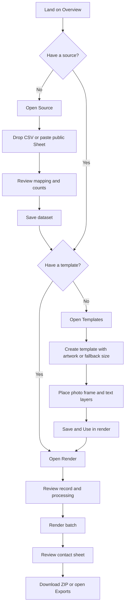

# Desrow — Application Flow

**Version** 0.1.0 · **Date** 30 October 2026

---

## 1. Route map

| Route | Screen | Primary job | Empty state |
| --- | --- | --- | --- |
| `/` | Overview | See workspace counts, pipeline progress start the next step | Stats read as “Import to begin”; empty recent renders card |
| `/source` | Source | Import a CSV/Sheet, review mapping, manage datasets | Import panel is always available; library explains no datasets |
| `/templates` | Templates | Create and manage master templates | “No templates yet” with create action |
| `/templates/[id]` | Template editor | Compose artwork, photo frame and text layers | Missing template explains local-only storage and links back |
| `/render` | Render bench | Choose inputs, tune processing, preview a record, run a batch | Input cards show missing source/template with next actions |
| `/exports` | Exports | Review saved batches, download assets/ZIP, delete history | “No batches exported yet” with render action |

Global navigation: Overview, Source, Templates, Render, Exports. Counts appear beside Source (datasets), Templates and Exports (runs). A local-workspace card states that data stays in the browser. The shell collapses to a top bar with horizontally scrolling navigation below the `lg` breakpoint.

## 2. First-run journey

The overview cards mirror this order and mark source/template readiness.

## 3. Source flow

### 3.1 Import

1. Choose **CSV file** or **Google Sheet** via the segmented control.
2. CSV:
   - Drop a file on the dashed zone or use **Browse file**.
   - A `.csv` up to 10 MB is accepted.
   - The file is read in-browser and parsed immediately.
3. Google Sheet:
   - Paste a `docs.google.com/spreadsheets/d/...` or published `/d/e/.../pubhtml` link.
   - **Fetch sheet** calls `/api/sheets`; the `gid` tab parameter is carried through.
   - Private or non-public sheets return a message about “Anyone with the link can view”.

### 3.2 Review

The staged review replaces the import panel (the page scrolls it into view).

- Edit the dataset name.
- Choose the **Name column** and **Portrait link column**; auto-detection preselects likely columns.
- See Rows / Named / Linked counts and a warning for records without a usable link.
- Inspect the first three records with thumbnails.
- **Save dataset** persists to IndexedDB and shows a success notice with **Continue to render**.
- **Cancel** discards the staged import; nothing is saved.

### 3.3 Library

The dataset browser lists saved datasets with record counts, column chips, name/portrait mapping, relative edit time and actions to inspect, select or delete. Selecting a dataset updates the persistent `desrow.selection.dataset` key so Render opens with it.

Deleting a dataset removes it from IndexedDB. Existing runs keep their stored items and copied dataset name; the ZIP manifest will omit columns that are no longer available.

## 4. Template flow

### 4.1 Create

1. **New template** opens the creation modal.
2. Enter a name.
3. Optionally upload **Master artwork** (PNG/JPEG/WebP, ≤ 8 MB, ≤ 8,000 px per side). Uploading:
   - previews the artwork,
   - sets width and height to its native dimensions,
   - locks the output canvas to the artwork size.
4. Without artwork, choose a preset (900 × 1200, 1200 × 1200, 1400 × 900, 1500 × 2000) or enter a fallback width/height (200–8,000 px).
5. Choose whether to include starter text layers.
6. **Create template** saves and routes to the editor.

If the artwork aspect and canvas differ, a warning notes that the image will be stretched to fill.

### 4.2 Editor layout

- **Header:** back, save status, editable template name, canvas metadata, Add text, Use in render.
- **Left rail:** Layers list — Canvas & artwork, Photo frame, each text layer, Add text layer.
- **Centre:** live canvas rendered by the real compositor with a placeholder portrait.
- **Right rail:** contextual inspector for the selected layer.

### 4.3 Canvas & artwork

- Edit name, exact width/height and canvas colour.
- Replace or remove artwork.
- A note confirms when the canvas was adopted from the artwork.
- If artwork dimensions differ from the canvas, a warning explains stretching.
- **Frame** shortcut selects the photo frame.

### 4.4 Photo frame

- Direct drag to move.
- Drag any of four corner handles to resize; minimum 5% width/height.
- Arrow keys nudge by 0.2% (Shift: 1%).
- Inspector: horizontal/vertical start, width, height, computed aspect ratio, corner radius, border width, border colour.
- Normalised values keep placement consistent at any output scale.

### 4.5 Text layers

- Direct drag to move; side handle changes box width.
- Arrow keys nudge.
- Inspector sections:
  - **Content:** layer name, text/token content, token chips, resolved preview.
  - **Typography:** typeface, weight, device font, custom font file, exact size, tracking, line height, max lines, opacity, alignment, colour, uppercase.
  - **Placement:** X, Y, box width.
  - **Delete text layer** with confirmation modal.
- Uploaded fonts appear under an “Uploaded” group and are embedded in the template.
- “Device” shows the currently applied local family.
- Typeface changes clamp weight to a supported value.

### 4.6 Saving and leaving

- Edits mark the template **Unsaved**, debounce for 700 ms, then save and show **Saved**.
- **Use in render** waits for a save, selects the template and routes to `/render`.
- **Back to templates** waits for a save.
- If the browser tab unmounts with unsaved edits, a final save is attempted.
- If saving fails, the status returns to Unsaved and navigation is blocked for explicit actions.

### 4.7 Delete template

From the gallery, the trash action opens a confirmation. Deleting removes the template from IndexedDB; existing runs retain their frames and template name.

## 5. Render flow

### 5.1 Readiness

`/render` resolves the selected dataset/template from workspace state. If either is missing, two input cards explain what is needed and link to Source/Templates. Otherwise it mounts the bench and defaults are loaded from localStorage (or `DEFAULT_PROCESSING`).

Selecting a different dataset resets per-record overrides, results and current run view. Selecting a different template keeps the current dataset and settings.

### 5.2 Setup

- Source dataset selector shows name and row count.
- Master template selector shows name and canvas size.
- Displays record count and frame size.
- Links to manage the source or edit the template.

### 5.3 Processing

Four tabs:

| Tab | Controls |
| --- | --- |
| Crop | Photo placement mode (face crop / fit in frame), face detection toggle, face height in frame, horizontal placement, vertical placement |
| Tone | Curve editor (add/drag/remove points), presets, contrast, brightness, red/green/blue channel mix, luminance reset |
| Grain | Amount, size, seed, shuffle |
| Output | Scale 1×/1.5×/2×, PNG/JPEG, JPEG quality, filename pattern with token chips, parallel renders |

Every control writes to the settings object; the whole object persists to localStorage. **Reset** restores defaults and clears stored settings.

### 5.4 Frame preview

- Shows the selected record rendered by the real compositor at a bounded preview scale.
- Status line: detection state, confidence and source URL; error/fallback copy when relevant.
- Previous/next record buttons and a labelled record selector.
- Drag the portrait to adjust crop position; scroll to change face height.
- In fit mode the portrait is contained in the frame and locked to horizontal centre; dragging adjusts vertical placement only and scrolling is disabled.
- Those interactions create a per-record override. Override sliders show/reset the same values. **Reset** clears the override.
- Record metadata lists every column.

Preview failures are isolated to the preview; they do not stop a batch.

### 5.5 Run batch

1. Optionally enter a batch name; default is `<dataset> · <template>`.
2. **Render N assets** captures a deep copy of settings/overrides and starts an abortable job.
3. Progress shows a bar, completed/total, rendered/failed/skipped counts and the latest active label.
4. Contact sheet fills as items complete; rendered items have a hover download action; clicking an item selects it in the preview when it belongs to the current dataset.
5. **Cancel** aborts pending work; in-flight rows may finish. Completed frames stay visible and are saved.
6. On completion, summary status is:
   - **completed** if no failures,
   - **partial** if any failures,
   - **cancelled** if the user aborted.
   Skipped records do not by themselves make the batch partial.
7. The summary and all items are written to IndexedDB. If that write fails, results remain usable in memory with an explicit error.
8. Actions: Download ZIP, Open exports, Clear current view.

### 5.6 Error matrix

| Condition | Behavior |
| --- | --- |
| Empty portrait link | Item `skipped`, “No portrait link in this record.” |
| Non-http(s) link | Item `skipped`, “The portrait value is not a supported http(s) link.” |
| 404/private image | Item `failed` with a sharing/link message |
| No face found | Renders with fallback crop + warning on the item |
| Detector cannot start | Disables detection for remaining rows, warns once, continues |
| Canvas/encode failure | Item `failed`, error surfaced; batch continues |
| Abort | Remaining rows are not started; run marked cancelled |
| IndexedDB save failure | Rendered items stay on screen; batch name is not saved to history |

## 6. Exports flow

1. `/exports` lists saved batches, newest first, with success/total and date.
2. Selecting a batch loads its items from IndexedDB.
3. Header actions: Download ZIP (rendered items only) and Delete batch.
4. Stats: Rendered, Failed, Skipped, Stored size.
5. Metadata strip: format, scale, JPEG quality, face detection, grain, curve point count.
6. Asset grid shows thumbnail, label, status, stored size and error text where present.
7. Rendered items have a download button for their original blob.
8. Delete confirmation states that the batch and all frames are removed and cannot be undone.

ZIP contents:

- Every rendered asset under its generated filename.
- `manifest.csv` with all records (including failed/skipped) when source columns are still available.
- `desrow-settings.json` with batch metadata and the exact processing recipe.

## 7. Overview flow

The overview is a launch surface, not an editor:

- Hero with Import source and Open render bench.
- Four workspace stats: Records, Templates, Assets exported, Last export.
- Four pipeline cards with readiness states linking to Source, Templates and Render.
- Recent renders table (or empty state) linking to Exports.
- Privacy footer.

## 8. Navigation and persistence rules

| State | Stored in | Lifetime |
| --- | --- | --- |
| Datasets, templates, runs, items | IndexedDB `desrow` | Until deleted or site data cleared |
| Selected dataset/template | localStorage `desrow.selection.dataset` / `.template` | Across reloads |
| Processing settings | localStorage `desrow.processing.v1` | Across reloads; Reset clears |
| Template edits | IndexedDB, 700 ms debounce | Persisted on save/unmount |
| Batch progress | React state + IndexedDB on completion | Lost if the tab closes mid-run |
| Downloads | Browser download | Outside the app |

Deep links: `/templates/[id]` requires the template to exist in this browser. If not, the page explains that it may have been deleted or belong to another workspace.

## 9. Keyboard and pointer interactions

| Context | Action | Result |
| --- | --- | --- |
| Editor canvas | Drag photo frame | Move frame |
| Editor canvas | Drag frame corner | Resize frame |
| Editor canvas | Drag text layer | Move layer |
| Editor canvas | Drag text side handle | Change box width |
| Editor canvas | Arrow keys | Nudge 0.2%; Shift = 1% |
| Editor canvas | Escape | Select canvas |
| Render preview | Drag portrait | Change crop X/Y for this record |
| Render preview | Scroll over frame | Change face height for this record |
| Global | Tab | Move focus; visible focus ring |
| Modal | Escape / backdrop | Close (except while a blocking action runs) |

Keyboard nudging is disabled while an input, textarea, select or contenteditable element has focus, so arrow keys keep their native editing behavior.

## 10. Empty, loading and error states

- **Workspace loading:** mono “Opening local workspace…” / “Opening template…”.
- **No dataset at render:** Input 01 card with Import source.
- **No template at render:** Input 02 card with Create a template.
- **No datasets:** source library panel with import guidance.
- **No templates:** empty state with Create your first template.
- **No runs:** exports empty state and overview empty recent renders.
- **Missing template route:** explanatory panel + Back to templates.
- **Import errors:** inline Notice with a specific remedy, not a generic toast.
- **Upload errors:** inline text in the inspector (artwork, font, device font).
- **Detector errors:** status pill and fallback warning; the batch continues.
- **Storage errors:** visible Notice; the app does not pretend the save succeeded.

## 11. Responsive behavior

- `lg` and up: fixed sidebar, three-column editor (layers / canvas / inspector), two-column render bench (controls / preview + batch).
- Below `lg`: top navigation, editor stacks canvas first, then layers, then inspector; render controls follow the preview/batch column.
- Below `sm`: action rows wrap, token chips scroll/wrap, contact-sheet grids drop to two columns.
- Precision editing remains usable on touch via drag handles, but the experience is designed for a trackpad/mouse and a wide canvas.
