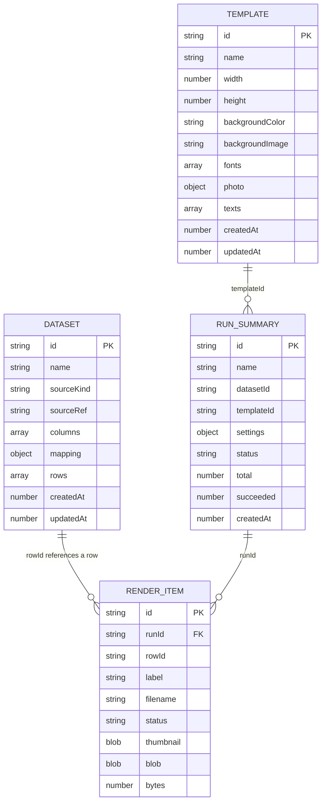

# Desrow — Database Schema

**Version** 0.1.0 · **Date** 30 October 2026 · **Storage** Browser IndexedDB via Dexie

---

## 1. Overview

Desrow is local-first. The entire workspace lives in the browser under the IndexedDB database named **`desrow`**. There is no server database, authentication or remote sync.

Dexie schema version: **1**.

```ts
this.version(1).stores({
  datasets: "id, updatedAt",
  templates: "id, updatedAt",
  runs: "id, createdAt, status",
  items: "id, runId, status",
});
```

The first column is the primary key. Other listed columns are indexes. The full objects are stored; fields not listed as indexes are not queryable through Dexie indexes but are available on the record.

## 2. Entity relationships



Dexie does not enforce foreign keys. `items.runId` is a logical relation; `deleteRun` removes the summary and its items in one transaction. `run.datasetId` and `run.templateId` are informational references; deleting a dataset or template does not delete run history.

## 3. Stores

### 3.1 `datasets`

| Field | Type | Required | Notes |
| --- | --- | --- | --- |
| `id` | `string` | yes | UUID primary key |
| `name` | `string` | yes | User-editable dataset name |
| `sourceKind` | `"csv" \| "sheet"` | yes | Import method |
| `sourceRef` | `string` | yes | Original filename or source URL |
| `columns` | `string[]` | yes | Deduplicated header names, in order |
| `mapping.nameColumn` | `string` | yes | Column used for labels and `{{name}}` |
| `mapping.imageColumn` | `string` | yes | Column used for portrait links |
| `rows` | `DatasetRow[]` | yes | One object per record |
| `rows[].id` | `string` | yes | UUID row key |
| `rows[].values` | `Record<string,string>` | yes | Column → trimmed cell value |
| `createdAt` | `number` | yes | Epoch ms |
| `updatedAt` | `number` | yes | Epoch ms; `listDatasets` orders by this descending |

Indexes: `id` (PK), `updatedAt`.

Dataset rows are embedded, not a separate store. A 5,000-row import is one record with 5,000 nested row objects. There is no per-cell index or full-text search.

### 3.2 `templates`

| Field | Type | Required | Notes |
| --- | --- | --- | --- |
| `id` | `string` | yes | UUID primary key |
| `name` | `string` | yes | Template name |
| `width` | `number` | yes | Canvas width in px; set by artwork or manual fallback |
| `height` | `number` | yes | Canvas height in px |
| `backgroundColor` | `string` | yes | Hex colour under the artwork |
| `backgroundImage` | `string \| null` | yes | Master artwork as a data URL; native size defines canvas |
| `fonts` | `TemplateFont[]` | optional | Embedded font files; absent on older/blank templates |
| `fonts[].id` | `string` | yes | UUID used in `custom:<id>` |
| `fonts[].label` | `string` | yes | Display label from the file name |
| `fonts[].dataUrl` | `string` | yes | Base64 font file, max 2 MB before encoding |
| `photo` | `PhotoLayer` | yes | Single photo frame |
| `photo.x` | `number` | yes | Normalised left, 0–1 |
| `photo.y` | `number` | yes | Normalised top, 0–1 |
| `photo.width` | `number` | yes | Normalised width, 0–1 |
| `photo.height` | `number` | yes | Normalised height, 0–1 |
| `photo.radius` | `number` | yes | Corner radius in template px |
| `photo.borderWidth` | `number` | yes | Border width in template px |
| `photo.borderColor` | `string` | yes | Hex colour |
| `texts` | `TextLayer[]` | yes | Ordered array; unlimited layers |
| `createdAt` | `number` | yes | Epoch ms |
| `updatedAt` | `number` | yes | Epoch ms; updated on autosave |

Indexes: `id` (PK), `updatedAt`.

#### `TextLayer`

| Field | Type | Notes |
| --- | --- | --- |
| `id` | `string` | UUID |
| `name` | `string` | Layer label in the rail |
| `content` | `string` | Supports `{{column}}`, `{{index}}` is filename-only |
| `x`, `y` | `number` | Normalised top-left of the text box, 0–1 |
| `width` | `number` | Normalised box width, 0–1 |
| `font` | `"sans" \| "serif" \| "mono" \| "local:<family>" \| "custom:<id>"` | Bundled, device or embedded |
| `size` | `number` | px at template resolution |
| `weight` | `number` | 100–900 |
| `letterSpacing` | `number` | px at template resolution |
| `lineHeight` | `number` | Multiplier |
| `maxLines` | `number` | 0 = unlimited; extra wrapped lines are hidden |
| `align` | `"left" \| "center" \| "right"` | Anchor inside the box |
| `color` | `string` | Hex |
| `uppercase` | `boolean` | Applied at render time |
| `opacity` | `number` | 0–1 |

`backgroundImage` and `fonts[].dataUrl` are base64 strings, not Blobs. This makes template records larger but keeps them self-contained and directly usable by `Image`/`FontFace` without asynchronous object-URL lifecycle management.

### 3.3 `runs`

| Field | Type | Required | Notes |
| --- | --- | --- | --- |
| `id` | `string` | yes | UUID primary key |
| `name` | `string` | yes | Batch name or default `<dataset> · <template>` |
| `datasetId` | `string` | yes | Snapshot of source ID |
| `datasetName` | `string` | yes | Copied for history |
| `templateId` | `string` | yes | Snapshot of template ID |
| `templateName` | `string` | yes | Copied for history |
| `settings` | `ProcessingSettings` | yes | Full copy of the run recipe |
| `status` | `"completed" \| "partial" \| "cancelled" \| "running"` | yes | `running` appears in the type; completed runs are written with a final state |
| `total` | `number` | yes | Dataset row count at run time |
| `succeeded` | `number` | yes | Rendered count |
| `failed` | `number` | yes | Failed count |
| `skipped` | `number` | yes | Skipped count |
| `createdAt` | `number` | yes | Epoch ms |
| `finishedAt` | `number` | optional | Epoch ms |

Indexes: `id` (PK), `createdAt`, `status`. `listRunSummaries` orders by `createdAt` descending.

The settings copy includes crop, tone (channel weights, curve, contrast, brightness), grain and output. This is what makes `desrow-settings.json` and the exports metadata possible after a template changes or is deleted.

### 3.4 `items`

| Field | Type | Required | Notes |
| --- | --- | --- | --- |
| `id` | `string` | yes | `${runId}:${rowId}`; PK |
| `runId` | `string` | yes | Logical FK to `runs.id`; indexed |
| `rowId` | `string` | yes | Logical FK to the row inside the dataset |
| `label` | `string` | yes | Person name or `Record N` |
| `filename` | `string` | yes | Generated, sanitised, unique within run |
| `sourceUrl` | `string` | yes | Original portrait URL |
| `status` | `"rendered" \| "failed" \| "skipped"` | yes | Indexed |
| `error` | `string` | optional | Reason for failure/skip |
| `warning` | `string` | optional | For example, fallback crop used |
| `thumbnail` | `string` | optional | JPEG data URL, max width 420 px |
| `blob` | `Blob` | optional | Full-resolution PNG/JPEG |
| `bytes` | `number` | optional | Blob size |
| `width` | `number` | optional | Output width |
| `height` | `number` | optional | Output height |
| `createdAt` | `number` | yes | Epoch ms |

Indexes: `id` (PK), `runId`, `status`.

`getRunItems(runId)` uses the `runId` index. Items include failed and skipped rows for the manifest; only rendered items have a blob and are included in the ZIP.

Storage note: full-resolution blobs dominate quota. A 1400 × 1800 PNG can be 1.5–2.5 MB depending on grain and content. Ten such assets can approach 20–25 MB before artwork/fonts.

## 4. Processing settings (embedded, not a store)

`ProcessingSettings` is persisted inside each run and separately in localStorage for the next run.

```ts
interface ProcessingSettings {
  crop: {
    detectFaces: boolean;
    fitToFrame: boolean;  // true: contain the whole portrait, horizontally centred
    faceScale: number;   // 8–100
    faceX: number;       // 0–100
    faceY: number;       // 0–100
  };
  tone: {
    channelWeights: { r: number; g: number; b: number }; // 0–1
    curve: CurvePoint[];                                  // 2–9 points, 0–1 each
    contrast: number;                                     // −50–50
    brightness: number;                                   // −50–50
  };
  grain: {
    amount: number;      // 0–70
    size: number;        // 0.4–4
    seed: number;        // 1–999999
  };
  output: {
    scale: 1 | 1.5 | 2;
    format: "png" | "jpeg";
    jpegQuality: number; // 50–100
    filenamePattern: string;
    concurrency: number; // 1–4
  };
}
```

## 5. localStorage keys

| Key | Value | Notes |
| --- | --- | --- |
| `desrow.selection.dataset` | Dataset ID | Last selected source; validated against the library |
| `desrow.selection.template` | Template ID | Last selected template; validated against the library |
| `desrow.processing.v1` | JSON `ProcessingSettings` | Clamped and sanitised on read; reset clears it |

Selection and settings are convenience state. If they point to deleted records or contain malformed JSON, the app falls back to the first available record or defaults.

## 6. Lifecycle and cascade behavior

| Action | Effect |
| --- | --- |
| Save dataset | `put` full dataset; `updatedAt` set by caller |
| Delete dataset | Removes the dataset record. Runs and items remain. Placeholder blocks cannot be re-resolved, and ZIP manifests fall back to omitting unavailable columns. |
| Save template | Autosave `put`; updates `updatedAt` |
| Delete template | Removes the template record. Existing runs and rendered items remain. |
| Complete batch | Transaction writes `runs.put(summary)` and `items.bulkPut(items)` |
| Delete batch | Transaction deletes all items with `runId` and the run record |
| Clear all data | `clearAllData()` clears datasets, templates, runs and items in one transaction. No current UI action calls it; site-data clearing has the same effect. |

## 7. Migrations

There is only version 1. No upgrade functions are registered.

Compatibility practices in code:

- `template.fonts` is optional and read as `template.fonts ?? []`.
- `backgroundImage` may be `null`.
- Font/face helpers defensively default missing layer arrays.
- Settings loading validates every field and range, discarding unknown structure.

Recommended when changing the schema:

1. Add a new Dexie version with an explicit `upgrade` function.
2. Normalise optional fields (fonts array, background image, dimensions) instead of relying on scattered `?? []`.
3. Never renumber or reorder primary keys.
4. Add a migration test using a fixture of the previous version.
5. Export/import the workspace before destructive migrations.

## 8. Quota, backup and privacy

- IndexedDB is origin-scoped. `localhost:3000` and a deployed origin are separate workspaces; changing port/host changes the workspace.
- Clearing site data, using a private window, or switching browser profiles removes access to the workspace.
- There is no automatic backup, export of the workspace, or cross-device sync.
- Data at rest is not encrypted by Desrow. Browser storage is protected by the browser profile, not by an application passphrase.
- Embedded artwork and font data can be large; multiple templates with 8 MB artwork and 2 MB fonts quickly consume significant quota.
- Full-resolution assets are the largest records. Use Exports → Delete batch to reclaim space.
- Thumbnails are retained separately from blobs, so a contact sheet can still render if a blob is missing.

## 9. Future server schema (planned, not implemented)

The following is a design direction only; no server database exists today.

```text
users            id, email, created_at
projects         id, owner_id, name, created_at
datasets         id, project_id, name, source_kind, source_ref, mapping_json, created_at
dataset_rows     id, dataset_id, position, values_json
templates        id, project_id, name, width, height, background_object_key,
                 photo_json, created_at, updated_at
template_texts   id, template_id, position, layer_json
template_fonts   id, template_id, family, object_key, weight
runs             id, project_id, dataset_id, template_id, settings_json,
                 status, counts_json, created_at, finished_at
render_items     id, run_id, row_id, filename, status, error,
                 asset_object_key, thumbnail_object_key, bytes, width, height
```

Planned differences:

- Artwork, fonts and rendered assets move to object storage; rows store object keys, not base64/Blobs.
- Dataset rows become a child table for querying and partial updates.
- Projects and membership enforce access; every query is scoped to the authenticated user or project.
- Runs become queue-backed and can be resumed.
- A migration must preserve the current canonical token names and `ProcessingSettings` shape so an exported recipe remains reproducible.
